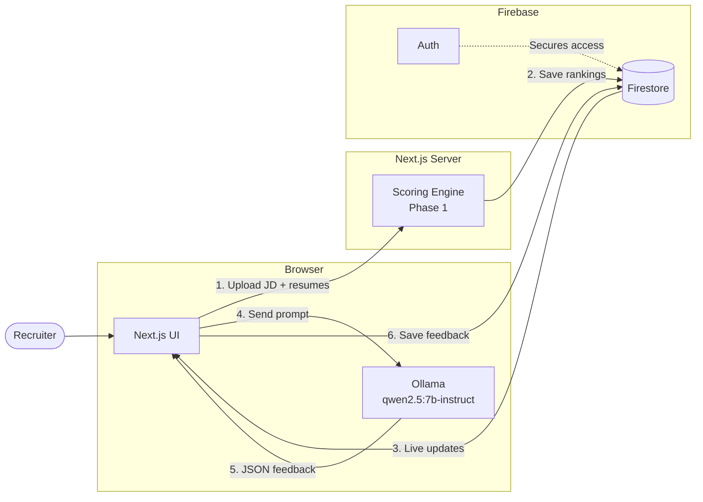
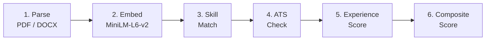

<div align="center">

# AI Recruiter

**Screen hundreds of resumes in seconds, with AI feedback that never leaves your machine.**


</div>

---

## Overview

AI Recruiter is a privacy-first recruitment platform. It ranks candidates against a job description using fast, deterministic scoring on the server, then generates recruiter-style written feedback with a **local LLM (Ollama)** running on your own machine.

Resume text is never sent to a third-party AI API.

| | Phase 1: Fast Ranking | Phase 2: AI Feedback |
|---|---|---|
| **Runs on** | Next.js server | Your browser + local Ollama |
| **Speed** | ~2–4 s per resume | Streams in after ranking |
| **Output** | Score (0–100), grade, skill match, ATS report | Soft-skill notes, red flags, structured JSON |
| **Cloud AI calls** | None | None |

---

## Features

- **Resume Ranker**: Bulk-screen resumes against a job description and get an instant ranked list.
- **ATS Score Finder**: Analyze a single resume against a specific job description.
- **Interview Question Generator**: Generate questions based on the gaps found in a candidate's profile.
- **Local AI Feedback**: Senior-recruiter style analysis powered by `qwen2.5:7b-instruct`.
- **Modern UI**: ShadCN UI, Tailwind CSS, dark mode, drag-and-drop uploads, live progress.
- **Secure Storage**: Firebase Auth and Firestore with per-user security rules.

---

## How It Works

The app uses **progressive enhancement**: you get ranked results first, and richer AI feedback fills in afterwards.



### Phase 1: Scoring Pipeline

Each resume goes through six deterministic steps on the server.



| Step | Description |
|------|-------------|
| **Parse** | Extracts text from PDF (`pdf-parse`) or DOCX (`mammoth`). |
| **Embed** | Creates 384-dim semantic embeddings with `all-MiniLM-L6-v2`, running locally in Node.js. |
| **Skill Match** | Compares required skills against skills found in the resume. |
| **ATS Check** | Rule-based check of formatting, sections, and machine-readability. |
| **Experience** | Heuristic score for years of relevant experience. |
| **Composite** | Weighted combination into a single 0–100 score with a letter grade. |

### Phase 2: AI Feedback

The browser calls Ollama directly at `http://localhost:11434`. Inference stays off the server, resume text stays on your network, and results are saved to Firestore through your authenticated session.

---

## Tech Stack

| Layer | Technology |
|-------|------------|
| Framework | Next.js 15 (App Router, Turbopack), React 18 |
| UI | ShadCN UI, Tailwind CSS, Framer Motion |
| Embeddings | `@xenova/transformers` with `all-MiniLM-L6-v2` |
| Local LLM | Ollama with `qwen2.5:7b-instruct` |
| Parsing | `pdf-parse`, `mammoth` |
| Backend | Next.js Server Actions (50 MB body limit) |
| Database & Auth | Firebase Firestore, Firebase Authentication |

---

## Quick Start

### Prerequisites

- Node.js 18 or later
- [Ollama](https://ollama.com/download) installed
- A Firebase project (Auth and Firestore enabled)

### 1. Set up Ollama

```bash
# Download the model
ollama pull qwen2.5:7b-instruct

# Start Ollama with browser access allowed
OLLAMA_ORIGINS="http://localhost:3000" ollama serve
```

> **Low-VRAM GPUs (e.g. 4 GB):** The model runs with a 1,024-token context. If an out-of-memory error occurs, the client retries automatically with a smaller context.

### 2. Install the project

```bash
git clone https://github.com/your-username/ai-recruiter.git
cd ai-recruiter
npm install
```

The first run downloads the embedding model (~23 MB) from Hugging Face. This happens once and is cached.

### 3. Configure environment variables

Create a `.env.local` file in the project root:

```bash
# Firebase
NEXT_PUBLIC_FIREBASE_API_KEY=your_api_key
NEXT_PUBLIC_FIREBASE_AUTH_DOMAIN=your_project_id.firebaseapp.com
NEXT_PUBLIC_FIREBASE_PROJECT_ID=your_project_id
NEXT_PUBLIC_FIREBASE_STORAGE_BUCKET=your_project_id.appspot.com
NEXT_PUBLIC_FIREBASE_MESSAGING_SENDER_ID=your_sender_id
NEXT_PUBLIC_FIREBASE_APP_ID=your_app_id

# Features
NEXT_PUBLIC_USE_EMULATORS=false
NEXT_PUBLIC_ENABLE_LOCAL_LLM=true
```

### 4. Run

```bash
npm run dev
```

Open [http://localhost:3000](http://localhost:3000).

---

## Configuration

All of these are optional.

| Variable | Default | Purpose |
|----------|---------|---------|
| `OLLAMA_BASE_URL` | `http://localhost:11434` | Ollama server address |
| `OLLAMA_PRIMARY_MODEL` | `qwen2.5:7b-instruct` | Model used for feedback |
| `OLLAMA_FALLBACK_MODEL` | `qwen2.5:7b-instruct` | Model used after an out-of-memory error |
| `NEXT_PUBLIC_ENABLE_FAST_MODE` | `false` | Set to `true` to skip the LLM and run Phase 1 only |

---

## Project Structure

```
src/
├── app/                      # Pages: resume-ranker, ats-score-finder,
│                             #        interview-question-generator, dashboard
├── ai/
│   ├── embeddings/           # Semantic similarity (all-MiniLM-L6-v2)
│   ├── flows/                # Server-side ranking and scoring flows
│   ├── local-llm/            # Ollama client and prompt templates
│   └── progressive-enhancement/
│                             # Phase 2 client-side feedback service
├── components/               # Reusable UI components
├── contexts/                 # Auth and loading contexts
├── hooks/                    # Custom React hooks
├── lib/
│   ├── ats/                  # ATS rule-based analyzer
│   ├── skills/               # Skill extraction and matching
│   ├── scoring/              # Weighted composite scorer
│   ├── processing/           # PDF and DOCX parsing
│   └── types.ts              # Shared types
└── services/
    └── firestoreService.ts   # Firestore CRUD and live subscriptions
```

---

## Troubleshooting

| Problem | Fix |
|---------|-----|
| AI feedback never appears | Make sure Ollama is running and started with `OLLAMA_ORIGINS="http://localhost:3000"`. |
| Out-of-memory errors | Use a smaller model through `OLLAMA_PRIMARY_MODEL`, or set `NEXT_PUBLIC_ENABLE_FAST_MODE=true`. |
| Slow first run | The embedding model is downloading. It is cached afterwards. |

---

## Contributing

Contributions are welcome, especially in these areas:

- **Prompt engineering**: improve the recruiter persona in `feedback-service.ts`.
- **Matching quality**: tune the semantic matching in `rank-candidates-progressive.ts`.
- **Model testing**: try other Ollama models such as `llama3` or `mistral`.

1. Fork the repository
2. Create a branch: `git checkout -b feature/your-feature`
3. Commit your changes and open a pull request

---

## License

Released under the [MIT License](./LICENSE).
